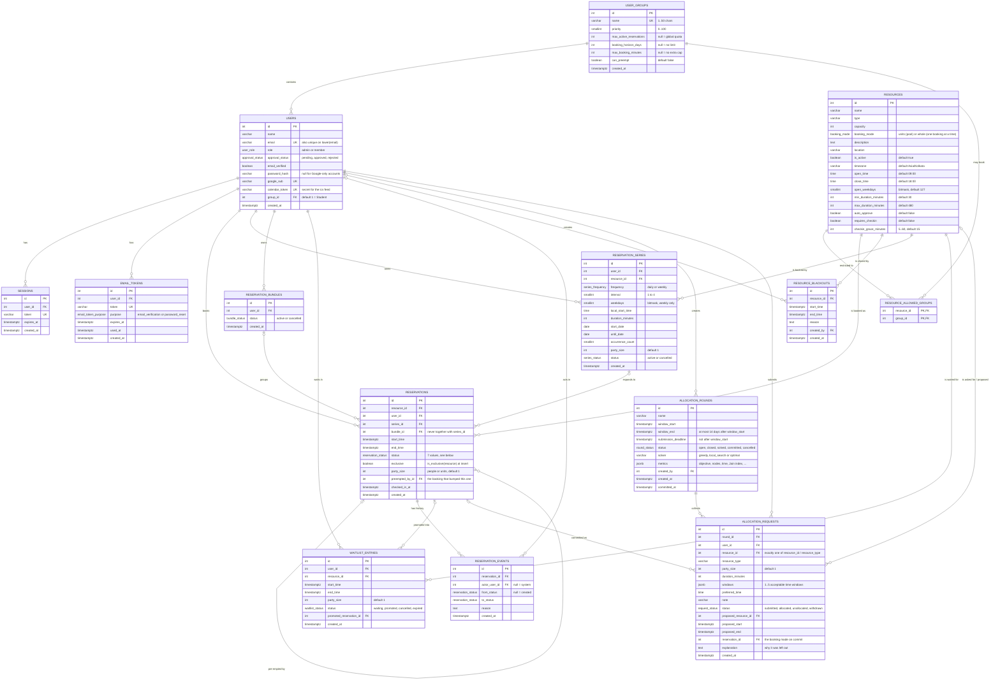

# Entity-Relationship Diagram

Generated from the real schema: a throwaway database was migrated to
`alembic upgrade head` and queried through `information_schema.columns`,
`pg_constraint` (`pg_get_constraintdef`) and `pg_indexes`, then dropped.
Migration head: `e7a9c1b3d5f6`. Extensions: `plpgsql`, `btree_gist`.
14 tables, 11 enum types.

## Diagram



## Enum types

| Type | Values |
|---|---|
| `approval_status` | pending, approved, rejected |
| `booking_mode` | units, whole |
| `bundle_status` | active, cancelled |
| `email_token_purpose` | email_verification, password_reset |
| `request_status` | submitted, allocated, unallocated, withdrawn |
| `reservation_status` | pending, confirmed, cancelled, rejected, expired, preempted, no_show |
| `round_status` | open, closed, solved, committed, cancelled |
| `series_frequency` | daily, weekly |
| `series_status` | active, cancelled |
| `user_role` | admin, member |
| `waitlist_status` | waiting, promoted, cancelled, expired |

Only `pending` and `confirmed` are **active** (`ACTIVE_STATUSES`); the newer
statuses `preempted` and `no_show` are inactive by construction, because both
exclusion constraints list the active set explicitly.

Bitmask convention (`resources.open_weekdays`, `reservation_series.weekdays`):
bit 0 = Monday … bit 6 = Sunday, so 127 = every day and 31 = Monday–Friday.

Seeded rows (migration `f8a1c3e5b7d9`, extended in `a7c9e1b3d5f2`):
`user_groups` 1 Student (priority 10), 2 Staff (30), 3 Faculty (50,
`can_preempt`). Every user starts in group 1.

## Constraints and special indexes

Exact definitions from `pg_get_constraintdef` / `pg_indexes`.

### Exclusion constraints (the core of double-booking safety)

| Name | Definition | Purpose |
|---|---|---|
| `no_overlap` | `EXCLUDE USING gist (resource_id WITH =, tstzrange(start_time, end_time) WITH &&) WHERE (((status = ANY (ARRAY['pending'::reservation_status, 'confirmed'::reservation_status])) AND exclusive))` | Two active bookings of the same exclusive resource (capacity 1 or booking mode `whole`) can never overlap in time. |
| `no_user_duplicate_reservation` | `EXCLUDE USING gist (resource_id WITH =, user_id WITH =, tstzrange(start_time, end_time) WITH &&) WHERE ((status = ANY (ARRAY['pending'::reservation_status, 'confirmed'::reservation_status])))` | One user can never hold two overlapping active bookings of the same resource (any capacity). |

Both are backed by GiST indexes of the same name; `btree_gist` lets the GiST
index handle the plain `=` comparisons together with the range `&&`.

### CHECK constraints

| Table | Name | Definition | Purpose |
|---|---|---|---|
| `allocation_requests` | `ck_alloc_requests_duration` | `CHECK ((duration_minutes > 0))` | Positive duration |
| `allocation_requests` | `ck_alloc_requests_party_size` | `CHECK ((party_size >= 1))` | At least one person / unit |
| `allocation_requests` | `ck_alloc_requests_resource_or_type` | `CHECK (((resource_id IS NULL) <> (resource_type IS NULL)))` | Exactly one of "this resource" or "any resource of this type" |
| `allocation_requests` | `ck_alloc_requests_windows` | `CHECK (((jsonb_typeof(windows) = 'array'::text) AND ((jsonb_array_length(windows) >= 1) AND (jsonb_array_length(windows) <= 5))))` | 1–5 acceptable windows |
| `allocation_rounds` | `ck_rounds_deadline_before_window` | `CHECK ((submission_deadline <= window_start))` | Requests close before the booked period starts |
| `allocation_rounds` | `ck_rounds_window_length` | `CHECK (((window_end - window_start) <= '14 days'::interval))` | A round covers at most two weeks |
| `allocation_rounds` | `ck_rounds_window_order` | `CHECK ((window_end > window_start))` | Non-empty window |
| `reservation_series` | `ck_series_duration` | `CHECK ((duration_minutes > 0))` | Positive duration |
| `reservation_series` | `ck_series_interval` | `CHECK ((("interval" >= 1) AND ("interval" <= 4)))` | Every 1–4 days/weeks |
| `reservation_series` | `ck_series_one_end_rule` | `CHECK (((until_date IS NULL) <> (occurrence_count IS NULL)))` | Exactly one of "until date" or "N occurrences" |
| `reservation_series` | `ck_series_party_size` | `CHECK ((party_size >= 1))` | At least one person / unit |
| `reservation_series` | `ck_series_weekdays` | `CHECK ((((frequency = 'weekly'::series_frequency) AND ((weekdays >= 1) AND (weekdays <= 127))) OR ((frequency = 'daily'::series_frequency) AND (weekdays IS NULL))))` | Weekdays required for weekly, forbidden for daily |
| `reservations` | `ck_reservations_party_size` | `CHECK ((party_size >= 1))` | At least one person / unit |
| `reservations` | `ck_reservations_series_or_bundle` | `CHECK (((series_id IS NULL) OR (bundle_id IS NULL)))` | A booking belongs to a series or a bundle, never both |
| `reservations` | `reservations_end_after_start` | `CHECK ((end_time > start_time))` | A booking always has positive length, even for direct SQL inserts |
| `resource_blackouts` | `ck_resource_blackouts_end_after_start` | `CHECK ((end_time > start_time))` | Non-empty maintenance window |
| `resources` | `ck_resources_checkin_grace` | `CHECK (((checkin_grace_minutes >= 5) AND (checkin_grace_minutes <= 60)))` | Sensible check-in grace period |
| `resources` | `ck_resources_duration_bounds` | `CHECK (((min_duration_minutes > 0) AND (max_duration_minutes >= min_duration_minutes)))` | Sensible duration limits |
| `resources` | `ck_resources_open_before_close` | `CHECK ((close_time > open_time))` | Opening hours are a real interval |
| `resources` | `ck_resources_open_weekdays` | `CHECK (((open_weekdays >= 1) AND (open_weekdays <= 127)))` | At least one open day, valid 7-bit mask |
| `user_groups` | `ck_user_groups_horizon` | `CHECK (((booking_horizon_days IS NULL) OR (booking_horizon_days > 0)))` | Positive horizon or none |
| `user_groups` | `ck_user_groups_max_active` | `CHECK (((max_active_reservations IS NULL) OR (max_active_reservations > 0)))` | Positive quota or the global one |
| `user_groups` | `ck_user_groups_max_minutes` | `CHECK (((max_booking_minutes IS NULL) OR (max_booking_minutes > 0)))` | Positive duration cap or none |
| `user_groups` | `ck_user_groups_name_length` | `CHECK (((char_length((name)::text) >= 1) AND (char_length((name)::text) <= 50)))` | Readable group names |
| `user_groups` | `ck_user_groups_priority` | `CHECK (((priority >= 0) AND (priority <= 100)))` | Priority on a 0–100 scale |
| `waitlist_entries` | `ck_waitlist_end_after_start` | `CHECK ((end_time > start_time))` | Non-empty waitlist slot |
| `waitlist_entries` | `ck_waitlist_party_size` | `CHECK ((party_size >= 1))` | At least one person / unit |

### UNIQUE and partial indexes

| Table | Index | Definition | Purpose |
|---|---|---|---|
| `users` | `ix_users_email` | `CREATE UNIQUE INDEX ix_users_email ON public.users USING btree (email)` | One account per email |
| `users` | `uq_users_email_lower` | `CREATE UNIQUE INDEX uq_users_email_lower ON public.users USING btree (lower((email)::text))` | **Expression index**: `Alice@x.com` and `alice@x.com` are the same account |
| `users` | `ix_users_google_sub` | `CREATE UNIQUE INDEX ix_users_google_sub ON public.users USING btree (google_sub)` | One account per Google identity |
| `users` | `ix_users_calendar_token` | `CREATE UNIQUE INDEX ix_users_calendar_token ON public.users USING btree (calendar_token)` | Feed token identifies exactly one user |
| `user_groups` | `uq_user_groups_name` | `CREATE UNIQUE INDEX uq_user_groups_name ON public.user_groups USING btree (name)` | Group names are unique (the `UNIQUE (name)` constraint) |
| `resource_allowed_groups` | `pk_resource_allowed_groups` | `CREATE UNIQUE INDEX pk_resource_allowed_groups ON public.resource_allowed_groups USING btree (resource_id, group_id)` | Composite primary key of the link table |
| `sessions` | `ix_sessions_token` | `CREATE UNIQUE INDEX ix_sessions_token ON public.sessions USING btree (token)` | Session lookup by cookie |
| `email_tokens` | `ix_email_tokens_token` | `CREATE UNIQUE INDEX ix_email_tokens_token ON public.email_tokens USING btree (token)` | Token lookup |
| `waitlist_entries` | `uq_waitlist_waiting_slot` | `CREATE UNIQUE INDEX uq_waitlist_waiting_slot ON public.waitlist_entries USING btree (user_id, resource_id, start_time, end_time) WHERE (status = 'waiting'::waitlist_status)` | **Partial**: one *waiting* entry per user per exact slot; history rows don't count |

### Other indexes (lookups)

`ix_allocation_requests_round_id`, `ix_allocation_requests_user_id`,
`ix_email_tokens_user_id`, `ix_reservation_bundles_user_id`,
`ix_reservation_events_reservation_id`, `ix_reservation_series_user_id`,
`ix_reservations_bundle_id`, `ix_reservations_series_id`,
`ix_resource_blackouts_resource_id`, `ix_sessions_user_id`,
`ix_users_group_id`, `ix_waitlist_entries_resource_id` (all `btree`), plus
the primary keys.

### Foreign keys

| From | To |
|---|---|
| `users.group_id` | `user_groups.id` |
| `resource_allowed_groups.resource_id`, `.group_id` | `resources.id`, `user_groups.id` (both `ON DELETE CASCADE`) |
| `sessions.user_id`, `email_tokens.user_id` | `users.id` |
| `reservations.user_id`, `.resource_id`, `.series_id`, `.bundle_id` | `users.id`, `resources.id`, `reservation_series.id`, `reservation_bundles.id` |
| `reservations.preempted_by_id` | `reservations.id` (self-reference) |
| `reservation_events.reservation_id`, `.actor_user_id` | `reservations.id`, `users.id` |
| `reservation_series.user_id`, `.resource_id` | `users.id`, `resources.id` |
| `reservation_bundles.user_id` | `users.id` |
| `resource_blackouts.resource_id`, `.created_by` | `resources.id`, `users.id` |
| `waitlist_entries.user_id`, `.resource_id`, `.promoted_reservation_id` | `users.id`, `resources.id`, `reservations.id` |
| `allocation_rounds.created_by` | `users.id` |
| `allocation_requests.round_id`, `.user_id` | `allocation_rounds.id`, `users.id` |
| `allocation_requests.resource_id`, `.proposed_resource_id`, `.reservation_id` | `resources.id`, `resources.id`, `reservations.id` |

## Plain-text version (for redrawing in the report)

```
USER_GROUPS (id PK, name UK, priority, max_active_reservations,
             booking_horizon_days, max_booking_minutes, can_preempt, created_at)
  1 ── * USERS
  * ── * RESOURCES  through RESOURCE_ALLOWED_GROUPS (resource_id, group_id) PK
                    (no rows for a resource = every group may book it)

USERS (id PK, name, email UK + UNIQUE lower(email), role, approval_status,
       email_verified, password_hash, google_sub UK, calendar_token UK,
       group_id FK, created_at)
  1 ── * SESSIONS (id PK, user_id FK, token UK, expires_at, created_at)
  1 ── * EMAIL_TOKENS (id PK, user_id FK, token UK, purpose, expires_at, used_at, created_at)

RESOURCES (id PK, name, type, capacity, booking_mode, description, location,
           is_active, timezone, open_time, close_time, open_weekdays,
           min_duration_minutes, max_duration_minutes, auto_approve,
           requires_checkin, checkin_grace_minutes)
  1 ── * RESOURCE_BLACKOUTS (id PK, resource_id FK, start_time, end_time,
                             reason, created_by FK->USERS, created_at)

RESERVATION_SERIES (id PK, user_id FK, resource_id FK, frequency, interval,
                    weekdays, local_start_time, duration_minutes, start_date,
                    until_date, occurrence_count, party_size, status, created_at)

RESERVATION_BUNDLES (id PK, user_id FK, status, created_at)

RESERVATIONS (id PK, resource_id FK, user_id FK, series_id FK nullable,
              bundle_id FK nullable, start_time, end_time, status, exclusive,
              party_size, preempted_by_id FK->RESERVATIONS nullable,
              checked_in_at, created_at)
   USERS 1 ── * RESERVATIONS * ── 1 RESOURCES
   RESERVATION_SERIES  0..1 ── * RESERVATIONS
   RESERVATION_BUNDLES 0..1 ── * RESERVATIONS   (never both: CHECK)
   RESERVATIONS 0..1 ── * RESERVATIONS          (preempted_by_id)
   EXCLUDE no_overlap:                    same resource + overlapping time,
                                          active and exclusive rows only
   EXCLUDE no_user_duplicate_reservation: same resource + same user +
                                          overlapping time, active rows only

RESERVATION_EVENTS (id PK, reservation_id FK, actor_user_id FK nullable,
                    from_status nullable, to_status, reason, created_at)
   RESERVATIONS 1 ── * RESERVATION_EVENTS

WAITLIST_ENTRIES (id PK, user_id FK, resource_id FK, start_time, end_time,
                  party_size, status, promoted_reservation_id FK nullable,
                  created_at)
   UNIQUE (user_id, resource_id, start_time, end_time) WHERE status = 'waiting'

ALLOCATION_ROUNDS (id PK, name, window_start, window_end,
                   submission_deadline, status, solver, metrics, created_by FK,
                   created_at, committed_at)
  1 ── * ALLOCATION_REQUESTS (id PK, round_id FK, user_id FK,
                              resource_id FK | resource_type, party_size,
                              duration_minutes, windows, preferred_time, note,
                              status, proposed_resource_id FK, proposed_start,
                              proposed_end, reservation_id FK, explanation,
                              created_at)
```
